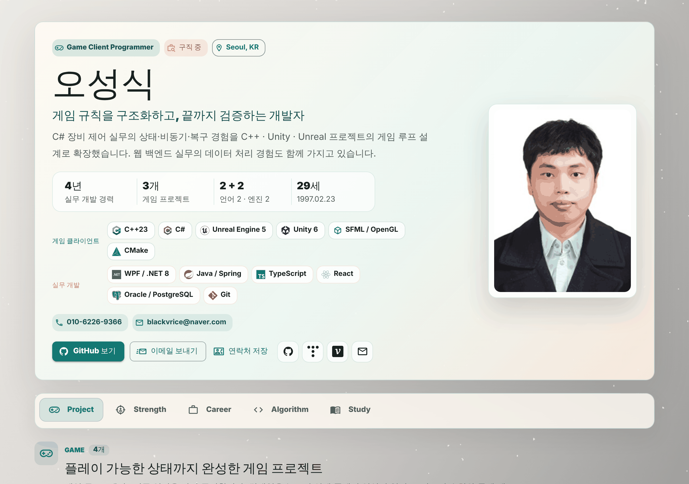
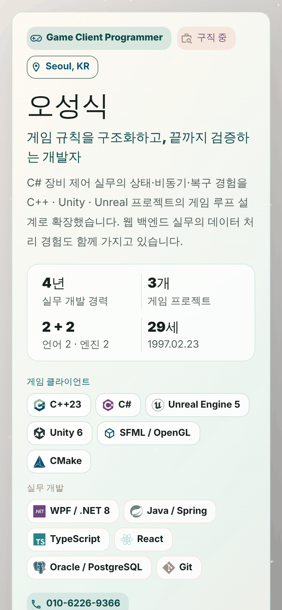

<div align="center">

# 오성식 · Game Client Programmer Portfolio

### 게임 규칙을 구조화하고, 끝까지 검증하는 개발자의 웹 포트폴리오

[](https://profile.blackvrice.com)
[](https://github.com/blackvrice/profile/actions/workflows/static.yml)
[](https://github.com/blackvrice)


<br>

<a href="https://profile.blackvrice.com">
  
</a>
&nbsp;
<a href="https://profile.blackvrice.com">
  
</a>

**👉 [profile.blackvrice.com](https://profile.blackvrice.com) 에서 바로 보실 수 있습니다.**

</div>

<br>

## 📌 이 사이트에서 볼 수 있는 것

C# 장비 제어 실무의 **상태 · 비동기 · 복구** 경험을 C++ · Unity · Unreal 게임 루프 설계로 확장한 과정을
**플레이 영상 · 수치 · 문제 해결 기록**으로 확인할 수 있도록 정리했습니다.

| 탭 | 내용 |
| --- | --- |
| 🎮 **Project** | **Game** — RTS(C++23) · Tycoon(Unity 6) · ArenaShooter(UE 5.6) · StarCraft Map Editor<br>**WPF Desktop** — PlotterCanvas &nbsp;·&nbsp; **Web** — backjoon · profile<br>프로젝트마다 플레이 영상, 핵심 수치, 검증 근거, 문제 → 해결 기록 |
| 🎯 **Strength** | 게임 클라이언트 요구 역량 ↔ 보유 역량 ↔ 근거 매핑, 개발 원칙(STATE → BOUNDARY → VERIFY → EVIDENCE) |
| 💼 **Career** | 앤서레이 · 노리시스템 · 위시정보기술 실무 경력 4년 (상세 직무 펼쳐보기) |
| 💻 **Algorithm** | 백준(solved.ac) / 프로그래머스 문제 해결 기록 |
| 📚 **Study** | 결정론적 시뮬레이션, 로직/렌더링 경계 설계 등 학습 중인 기술 관심사 |

<br>

## ✨ 주요 기능

- **플레이 영상 썸네일** — `videoId`만 넣으면 YouTube 썸네일과 재생 링크가 자동 생성 (고해상도 썸네일이 없으면 기본 썸네일로 대체)
- **데이터 주도 구성** — 프로젝트 · 경력 · 역량을 데이터 파일로 분리해, 새 프로젝트는 데이터만 추가하면 화면이 따라옴
- **바로 연락할 수 있는 히어로** — 이메일 · 전화번호 클릭 복사, 메일 보내기, **연락처(vCard) 저장** 버튼
- **검색 · 공유 최적화** — `react-helmet-async`로 title · description · Open Graph · Twitter Card, `schema.org/Person` JSON-LD 적용
- **반응형 · 접근성** — 모바일 레이아웃, 스크롤 가능한 고정 탭, `aria-label` / `role` 속성 적용
- **자동 배포** — `master`에 push하면 GitHub Actions가 빌드해 GitHub Pages(커스텀 도메인)로 배포

<br>

## 🗂 프로젝트 구조

```
src/
├── App.tsx            # 테마, 탭 구성, Study 패널
├── layout.tsx         # 히어로(소개 · 스킬 · 연락처 · vCard), SEO 메타
├── Project.tsx        # 프로젝트 카드 · 영상 썸네일 · 그룹(Game / WPF / Web)
├── ProjectData.ts     # 프로젝트 데이터
├── Strength.tsx       # 역량 매핑 표 · 개발 원칙
├── Career.tsx         # 경력 카드
├── CareerData.ts      # 경력 데이터
└── Algorithm.tsx      # 알고리즘 풀이 기록 링크
.github/workflows/static.yml   # GitHub Pages 배포
docs/                          # README 미리보기 이미지
```

<br>

## ✏️ 내용 수정하기

문구와 데이터는 대부분 데이터 파일에 모여 있습니다.

| 파일 | 수정 대상 |
| --- | --- |
| `src/ProjectData.ts` | 프로젝트 목록 · 그룹(`game` / `wpf` / `web`), 수치, 기술 태그, 문제 해결 기록, **플레이 영상 ID(`videoId`)** |
| `src/CareerData.ts` | 경력 기간, 직무, 상세 항목, 기술 스택 |
| `src/Strength.tsx` | 역량 매핑 표(`fitRows`), 개발 원칙, 협업 태도 |
| `src/layout.tsx` | 히어로 소개 문구, 스킬 그룹, 연락처, vCard, SEO 메타 |
| `src/App.tsx` | 탭 구성, Study 항목 |

> `videoId`가 비어 있으면 영상 썸네일은 숨겨지고 "영상" 버튼은 비활성 상태가 됩니다.
> YouTube 영상 ID(예: `https://youtu.be/g9drIxSF76o` → `g9drIxSF76o`)를 채우면 자동으로 활성화됩니다.

<br>

## 🛠 개발

```bash
npm install
npm run dev      # 로컬 개발 서버
npm run build    # 타입 체크 + 프로덕션 빌드
npm run lint     # ESLint
npm run preview  # 빌드 결과 미리보기
```

<br>

<div align="center">

**게임 클라이언트 포지션 제안 · 문의 환영합니다**

[](mailto:blackvrice@naver.com)
[](https://blackvrice.tistory.com)
[](https://velog.io/@blackvrice/posts)

</div>
